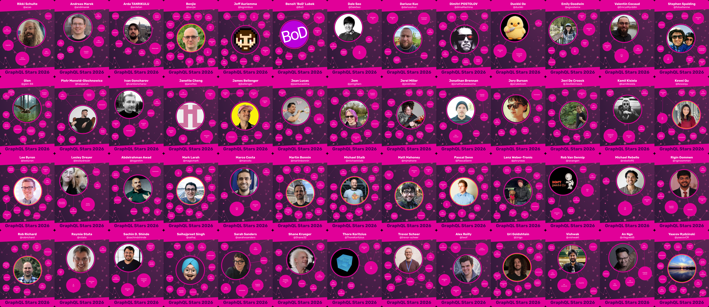

[][stars-2026]

GraphQL wouldn't be what it is today without the incredible people who make up
our community. From maintainers and contributors to educators, event organisers,
speakers, and advocates, thousands of people around the world dedicate their
time and energy to making GraphQL better for everyone.

Today, we're delighted to announce the **2026 GraphQL Stars** alongside the
brand new **People of GraphQL** website!

## Celebrating our stars 🌟

At GraphQLConf 2024 we introduced GraphQL Stars: a programme to recognise and
celebrate some of the people who go above and beyond to represent the needs and
desires of our community and help push the technology forward at our working
groups. With our conference having been in May this year, it wasn't yet
time for the Stars announcement; so, this year we're doing it virtually!

2026 marks the third year of GraphQL Stars, and though there are many faces
you'll recognize from previous years, it's always great to see some new faces
join the fold!

**[Meet our 2026 GraphQL Stars →][stars-2026]**

We couldn't be more grateful for all that these folks have worked on! If you see
your name amongst the GraphQL Stars 2026, please fill out [this form][stars-form] and we'll
aim to get your card in the post ready for it to take pride of place in your
Zoom background!

[I'm a star, please send me my card!][stars-form]

## Introducing: People of GraphQL

Recognition shouldn't be limited to a single announcement, and our community is
much bigger than any one programme.

That's why we're also launching **[People of
GraphQL](https://people.graphql.org)**: a new home for celebrating key members
of our community.

Alongside our GraphQL Stars from 2024, 2025, and 2026, you can explore the
people who help make GraphQL what it is, including:

- Members of the GraphQL Working Groups helping guide the evolution of GraphQL.
- Our GraphQL Ambassadors, spreading knowledge and enthusiasm around the world.
- Speakers who have shared their knowledge and insights at our conferences.

It's a celebration of the people who make our GraphQL community what it is:
vibrant, innovative, and welcoming!

**[Meet the people of GraphQL →](https://people.graphql.org)**

## You're our universe 💖

GraphQL is more than a specification, a query language, or a collection of
open-source projects. It's a global community of people who share ideas, solve
problems, teach each other, and build things together.

To our 2026 GraphQL Stars: thank you, and congratulations! And to everyone
else who contributes to making this community such a wonderful place: thank you,
too! We couldn't do this without you.

**Thank you!**

[stars-form]: mailto:operations@graphql.org?subject=You%20said%20there%20would%20be%20a%20form
[stars-2026]: https://people.graphql.org/stars/2026
